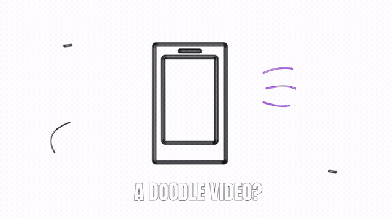

# ✍️ Doodle Scribe

> Hand-drawn explainer videos made by your AI agent — from a single sentence to a finished, word-synced MP4.



**Doodle Scribe** is an agent skill: install it once, then just tell your agent what the video should be about. It writes the script, generates (or transcribes) the voiceover, storyboards the film for your approval, builds a self-contained animation player, QA-checks frames, and renders a polished **H.264 MP4** — with a photoreal drawing hand, word-level voice sync, and a generated sound design mixed under the narration.

It ships with **two looks**:

| Profile | Look |
|---|---|
| **Doodle Scribe** (flagship) | Dense black-line doodles on white paper, revealed stroke-by-stroke under a photoreal hand; outlined display type; hard cuts between scenes |
| **Whiteboard Explainer** | Dry-erase marker on a glossy whiteboard, camera traveling across one big drawn world |

---

## Works with your agent

Any agent that reads `SKILL.md` files can use this skill:

- **OpenCode**
- **Claude Code**
- **Codex CLI**
- **Cursor**
- **Windsurf**
- **Gemini CLI**
- **Cline / Amp / others** — anything that can read a markdown file and run shell commands can follow the instructions in [`SKILL.md`](SKILL.md).

You do not need this repo checked out anywhere special. The skill is a folder; your agent just needs to find it.

---

## Install

### Option A — one command (universal installer)

```bash
npx skills add arifbuildsai/doodle-scribe
```

This installs the skill into every agent it detects on your machine (Claude Code, OpenCode, Codex, Cursor, Windsurf, and more).

### Option B — let your agent install it (recommended)

Paste this into your agent:

```text
Install the "Doodle Scribe" skill from https://github.com/arifbuildsai/doodle-scribe

Do the following:
1. Clone the repo to a temporary folder.
2. Copy the whole folder into your skills directory:
   - OpenCode: ~/.config/opencode/skills/doodle-scribe
   - Claude Code: ~/.claude/skills/doodle-scribe
   (OpenCode also reads ~/.claude/skills, so either location works for both.)
   - Codex CLI: ~/.codex/skills/doodle-scribe (recent builds)
   - Any other agent: clone anywhere you can always read, and remember the path.
3. Check the requirements from the README: node >= 18, ffmpeg on PATH, Chrome/Chromium
   present. In a scratch directory run `npm i puppeteer` (it uses the system Chrome,
   no big download) so renders work later.
4. Verify the skill loads: read its SKILL.md and confirm you understand the workflow.
5. Tell me it's ready and what I should say to make my first video.
```

### Option C — manual clone

```bash
# OpenCode
git clone https://github.com/arifbuildsai/doodle-scribe.git ~/.config/opencode/skills/doodle-scribe

# Claude Code (OpenCode reads this folder too)
git clone https://github.com/arifbuildsai/doodle-scribe.git ~/.claude/skills/doodle-scribe

# Codex CLI (recent builds with skills support)
git clone https://github.com/arifbuildsai/doodle-scribe.git ~/.codex/skills/doodle-scribe
```

Any other agent: clone the repo anywhere permanent, then add one line to your `AGENTS.md` /
system instructions: *"For hand-drawn video requests, read and follow `<path>/SKILL.md`."*

---

## Requirements

| Dependency | Why | Check |
|---|---|---|
| Node.js ≥ 18 | render + TTS + SVG converter scripts | `node --version` |
| ffmpeg on PATH | video encode + audio mix | `ffmpeg -version` |
| Chrome or Chromium | headless frame capture (puppeteer can also use its own Chromium) | `google-chrome --version` |
| `puppeteer` npm package | installed per project with `npm i puppeteer` | — |
| `ELEVENLABS_API_KEY` env var | only for voiceover generation — skip it if you'll attach your own audio | — |

No API keys are bundled, nothing phones home. The only network use: ElevenLabs (if you generate a voiceover) and Google Fonts in the player preview.

---

## Make your first video

Tell your agent any of these:

```text
Make a doodle video about why the sky is blue
```
```text
Whiteboard explainer on how hawala transfers work — here's my voiceover file: vo.mp3
```
```text
A 60-second doodle film called "The Little Star Nobody Noticed", emotional and heartwarming.
Here's the story: …
```

What the agent does (the workflow in `SKILL.md`):

1. **Script** — 6–10 spoken lines (or uses yours verbatim)
2. **Voiceover** — ElevenLabs with **word-level timestamps** (`WORDS.tsv`), or transcribes your attached audio itself
3. **Storyboard** — a visual beat-by-beat page **shown to you for approval** before building
4. **Build** — copies the template player and fills its marked `CONTENT` blocks with items timed to your words
5. **QA** — captures frames mid-draw and checks layout, hand position, text
6. **Render** — headless-Chrome capture → offline sound render → ffmpeg mix (voice-forward, effects ducked) → **MP4, QuickTime-safe**

Every stroke is drawn on in sequence and the hand's marker tip rides the newest ink — nothing fades or slides in. It genuinely looks drawn, because the renderer only ever advances a drawing.

---

## How the art works

This is the part that makes Doodle Scribe different from "AI image slideshows":

- **True stroke-order drawing** — line-art SVGs (e.g. [Openmoji](https://openmoji.org), CC BY-SA 4.0) are flattened into pen strokes by `scripts/svg2strokes.mjs`, and the hand traces the actual outlines: pen lifts, real drawing sequence.
- **Procedural doodles** — stars, faces, arrows, paths, beams, sparkles are authored in code as stroke lists, so protagonists can change expression between scenes (sad → determined → smiling) at zero cost.
- **Wipe-reveal raster art** — generated or supplied raster art is also supported (`scribe()`), revealed along a serpentine path; `keyLineArt()` handles textured paper automatically.
- **Whiteout fills** — foreground objects (a cloud, say) paint real paper-white as they draw, so they genuinely *cover* the art behind them.

The bundled hand photo (`doodle-scribe/hand-reference.jpg`) was generated by the author and is free to use and redistribute. Swap in your own hand with the per-file calibration table (`HAND_CONF`: tip position, rotation, length — one line per hand image).

---

## Voiceover

- **ElevenLabs** — set `ELEVENLABS_API_KEY`. Default voice is the public preset "Alice"; pick another with `--voice <id|name>` or `ELEVENLABS_VOICE_ID`. Voice clones require a plan that permits them — the script surfaces plan errors instead of silently swapping voices.
- **Your own audio** — hand your agent any audio file; it transcribes with word-level timestamps and syncs to your take.
- Formats are handled automatically (`pcm_44100` falls back to `mp3_44100_128` and converts to WAV when your plan needs it).

---

## Art sources & attribution

| Source | License | Notes |
|---|---|---|
| [Openmoji](https://openmoji.org) black line-art SVGs | **CC BY-SA 4.0** | Best stroke-order source. **Attribution required** — put this in your video description: *Doodle line art: Openmoji — openmoji.org — CC BY-SA 4.0* |
| SVG Repo | per-vector | Direct downloads work (`/download/<id>/<slug>.svg`) but HTML pages rate-limit bots, and many icons are **filled silhouettes** — unusable for stroke-order drawing. Prefer line-art |
| Google Flow / Nano Banana | your account | Optional for custom hero characters the library can't cover |
| Your own doodles | yours | Any raster art works via the wipe-reveal path |

Keep an `assets/SOURCES.md` manifest in each project (a sample is included) so attribution is always handled.

---

## License

- **Code** (all scripts, templates, engine): MIT — see [LICENSE](LICENSE)
- **`doodle-scribe/hand-reference.jpg`**: generated by the author, free to use and redistribute with the skill
- **Art you fetch** (Openmoji etc.): keeps its own license — Openmoji is CC BY-SA 4.0 and requires attribution in published videos
- Videos you make are yours.

---

## Troubleshooting

- **"Chrome not found"** — install Google Chrome, or let puppeteer download its own Chromium (`npx puppeteer browsers install chrome`). The scripts try Chrome channel → system paths (`/usr/bin/google-chrome*`, `chromium`) → bundled Chromium.
- **`Cannot find module 'puppeteer'`** — run `npm i puppeteer` in your project directory. If a script lives elsewhere, launch node with `NODE_PATH=/path/to/project/node_modules`.
- **Blank frames in QA** — the player must finish loading before seeking; `qa_frames.js` waits for `window.__ready`. Make sure `assets/strokes.js` exists if your page references it.
- **ElevenLabs 401 `ivc_not_permitted`** — your plan doesn't allow instant voice clones. Use a preset voice or attach your own audio.
- **SVG Repo pages 429/reset** — normal bot protection. Use direct `/download/` URLs, or stick to Openmoji for line art.
- **Storyboard approval** — the workflow shows a storyboard page and waits for your OK before building. Say "skip the storyboard" to go straight to the film.

---

## Credits

- Built as an agent-native pipeline: the author's films (a 30s doodle short and a 63.5s story film) were made end-to-end by an AI agent with this skill before it was packaged.
- [Openmoji](https://openmoji.org) — the line-art foundation (CC BY-SA 4.0)
- [ElevenLabs](https://elevenlabs.io) — voiceover + word timestamps
- Puppeteer + ffmpeg — capture and mix
